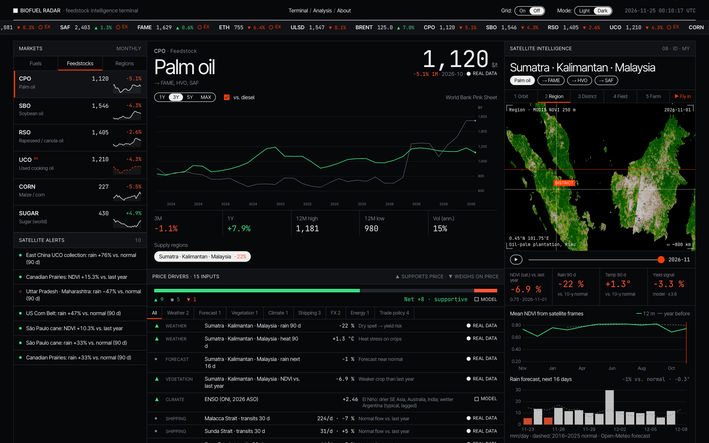
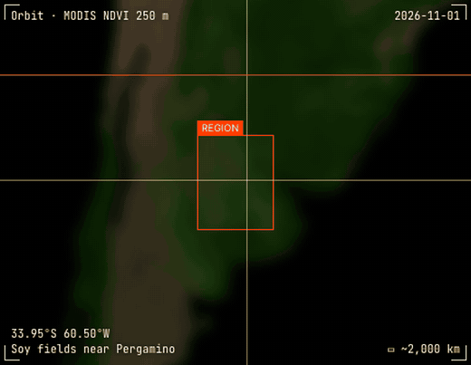
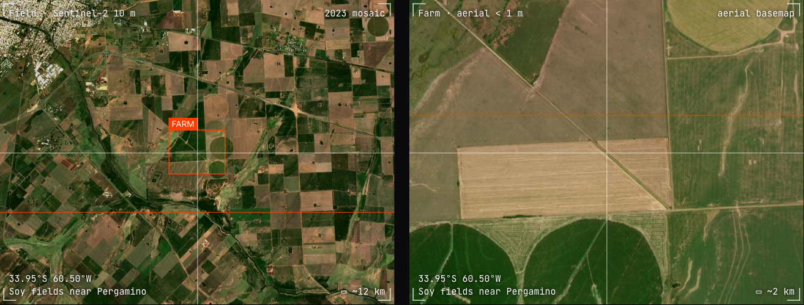
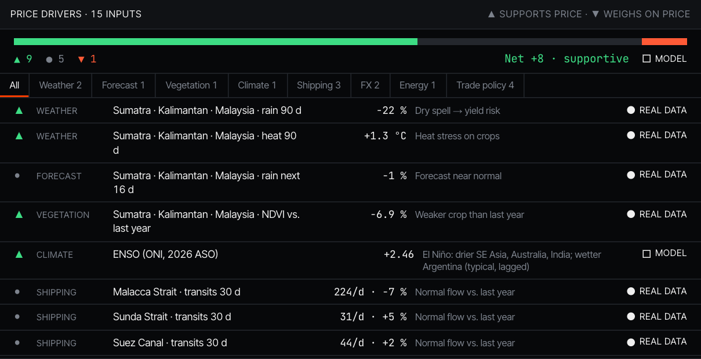

# Biofuel Radar

> **Research prototype: what is a satellite signal worth in biofuel feedstock markets — and how far can you trust it?**

**▶ Live demo: [pfrohlfs-lab.github.io/biofuel-radar](https://pfrohlfs-lab.github.io/biofuel-radar/)** · runs in the browser, no login, no install



Biofuel Radar is a single-page dashboard that follows the chain *field → harvest → feedstock supply → prices & spreads → trading signal* for FAME, HVO, SAF and ethanol. It puts an uncertainty band on every step. It is a demo for a research project on the **value and credibility of Earth-observation and weather signals** in feedstock markets (palm, soybean, rapeseed/canola, corn, sugar cane, used cooking oil). The aim is to make the research question concrete. It is not a finished model.

## What it shows

<table>
<tr>
<td width="50%"></td>
<td width="50%"></td>
</tr>
<tr>
<td><sub>"Fly in" from orbit to a single farm: MODIS 250 m → Sentinel-2 10 m → sub-metre aerial (Pergamino, Argentina)</sub></td>
<td><sub>Field level (Sentinel-2, 10 m) and farm level (aerial, &lt; 1 m) of the same location</sub></td>
</tr>
</table>

- **Markets watchlist:** fuels (HVO, SAF, FAME, ethanol, diesel, Brent) and feedstocks (palm, soybean, rapeseed oil, UCO, corn, sugar), plus a regions tab and live satellite alerts.
- **Instrument view:** price chart vs. diesel, 3M/1Y change, 12M range, volatility, linked supply regions.
- **Global vegetation map:** 12 monthly MODIS NDVI frames as a time-lapse, with the supply regions for the selected product highlighted.
- **Satellite intelligence:** zoom from orbit → region → district → field → single farm, a "fly in" animation, NDVI time-lapse, NDVI/Sentinel overlay, mean NDVI vs. last year decoded from the satellite frames, weather anomalies and a yield signal.
- **Price drivers:** every input for the selected product in one matrix (weather, 16-day forecast, NDVI, ENSO, shipping chokepoints, producer FX, diesel, trade policy). Each input is marked ▲ supports or ▼ weighs on price, and a gauge shows the net balance.
- **Shipping, FX & trade:** IMF PortWatch chokepoint transits (incl. tankers), NOAA ENSO index, producer currencies vs. USD, and a curated list of tariffs, levies and export taxes.
- **Analysis tabs:** signal & credibility (scenario chain, value of a trusted signal), spreads, policy & demand (11 mandates), data & method.



## Data

Each figure in the dashboard is labelled **REAL DATA**, **MODEL** or **EXAMPLE**.

| Layer | Source | Status |
|---|---|---|
| Vegetation (NDVI) | NASA GIBS, MODIS Terra 8-day | real |
| Field imagery | Sentinel-2 cloudless 2023 by EOX | real |
| Farm imagery | Esri World Imagery · USDA NAIP | real |
| Weather | Open-Meteo historical API (ERA5) | real |
| Weather forecast | Open-Meteo forecast API (16 days) | real |
| Shipping | IMF PortWatch chokepoint transits | real |
| ENSO | NOAA CPC Oceanic Niño Index | real |
| FX | ECB reference rates via Frankfurter | real |
| Trade policy | curated list of tariffs, levies, export taxes | to verify |
| Feedstock & crude prices | World Bank Pink Sheet (monthly) | real |
| Diesel | U.S. EIA, NY Harbor ULSD (monthly) | real |
| HVO, SAF, FAME, ethanol, UCO | **simulated**, because real assessments are paywalled | example |
| Yield / supply / price links | transparent **illustrative** model | model |

**Important:** HVO, SAF, FAME, ethanol and UCO prices are simulated, and the yield → supply → price model is illustrative, not estimated. The prototype shows the *structure* of the question. It does not answer it. Not investment advice.

## Licences and attribution

The imagery and data belong to their providers and are used here for non-commercial research and demonstration under their terms:

- **Sentinel-2 cloudless 2023** by [EOX IT Services GmbH](https://s2maps.eu), contains modified Copernicus Sentinel data 2023. Licence: [CC BY-NC-SA 4.0](https://creativecommons.org/licenses/by-nc-sa/4.0/).
- **Esri World Imagery**: Source: Esri, Maxar, Earthstar Geographics, and the GIS User Community. Used for non-commercial demonstration with attribution under the [Esri terms of use](https://www.esri.com/en-us/legal/terms/full-master-agreement).
- **USDA NAIP** aerial imagery: public domain (U.S. Department of Agriculture, Farm Service Agency).
- **NASA GIBS / MODIS Terra NDVI**: courtesy of NASA EOSDIS [Global Imagery Browse Services](https://earthdata.nasa.gov/gibs). NASA data are freely available without restriction.
- **Open-Meteo** weather data: [open-meteo.com](https://open-meteo.com/), licensed [CC BY 4.0](https://creativecommons.org/licenses/by/4.0/). Historical data based on Copernicus ERA5 (ECMWF).
- **World Bank** Commodity Price Data (Pink Sheet): [worldbank.org/commodity-markets](https://www.worldbank.org/en/research/commodity-markets), [CC BY 4.0](https://creativecommons.org/licenses/by/4.0/).
- **U.S. Energy Information Administration (EIA)**: NY Harbor ULSD spot price, public domain.
- **IMF PortWatch**: [portwatch.imf.org](https://portwatch.imf.org/), daily chokepoint transit calls (IMF / University of Oxford, based on AIS data).
- **NOAA Climate Prediction Center**: [Oceanic Niño Index](https://www.cpc.ncep.noaa.gov/data/indices/oni.ascii.txt), public domain.
- **European Central Bank** euro reference rates via [Frankfurter](https://frankfurter.dev/).
- Country outlines: [world-atlas](https://github.com/topojson/world-atlas) (Natural Earth, public domain).

Because of the non-commercial imagery licences (EOX, Esri), this repository and the live demo must not be used commercially.

## Run locally

```bash
npm install
npm run dev
```

The repository ships with a data snapshot (`public/data`, `public/img`), so the dashboard runs without fetching anything. To refresh the snapshot (no API keys needed):

```bash
python3 scripts/fetch_data.py      # prices + weather (needs openpyxl)
python3 scripts/fetch_imagery.py   # satellite frames, field and farm views (needs Pillow)
python3 scripts/fetch_drivers.py   # forecast, ENSO, shipping, FX
```

Stack: React, TypeScript, Vite, d3 (geo, scale, shape), topojson. There is no backend: the scripts fetch the data and the app serves it as static files. The live demo is published to GitHub Pages with `scripts/deploy_pages.sh`, which builds the app and pushes it to the `gh-pages` branch.

---

Peter Rohlfs, TUM · research prototype, 2026
